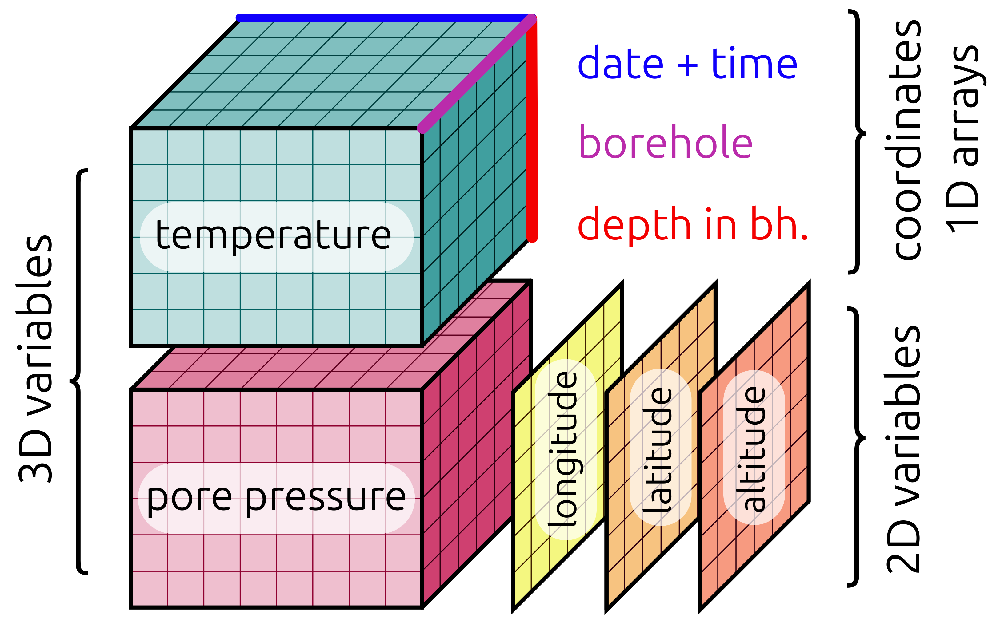
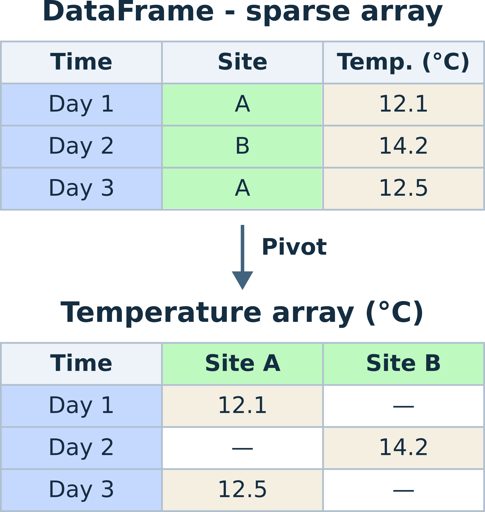

# zarr-fuse

## Overview


**zarr-fuse** is a Python library and web application for the collaborative collection and publication of scientific
datasets according to the [FAIR principles](https://www.gofair.foundation/fair-principles).

**Development status.** Version 1.0 is targeted for June 2027. The features below describe the planned release.
Use current releases for evaluation only.

1. **Define the dataset.** A data steward creates the data schemas and configures the data curation pipelines using
   built-in filters or custom Python code.
2. **Contribute data.** Contributors can upload files through a web interface generated from the input data schema.
   Continuous data streams can be set up for instruments and services.
3. **Curation and merge.** `Ingress` automatically standardizes incoming data and checks it against the input schema.
   The configured pipeline can then merge each contribution into the common dataset while preserving links to the
   original dataset.
4. **Inspect and revise.** Use the ZF-view dashboard to review merged or intermediate datasets. Fix the data or adjust
   the pipeline, then rerun the pipeline.

### Define the dataset

A schema records what each quantity means, how it is indexed, which units to use, and which values are allowed. Data
stewards use schemas to define the structure of datasets and configure pipelines to validate, standardize, curate,
transform, or merge contributions as the common dataset grows.

### Contribute data

The `ingress` service can fetch data such as weather forecasts from online sources or receive measurements sent by a
monitoring station. Scientists can also upload individual measurements or data from an in situ campaign.
These routes let teams combine long-running monitoring with occasional field measurements in the same dataset.
All raw data are stored for future processing or reprocessing.

### Curation and merge

The curation workflow uses readers for different input formats and processes the data in a common form, a
multidimensional [xarray dataset][xarray]. In such a dataset, variables can share axes or use different ones.
Coordinates label positions along those axes with values such as timestamps and site names, as shown in the left
figure below.

A pandas [DataFrame][pandas] is a table-shaped special case, with variables in columns and individual observations in
rows. Tables are flexible for small datasets and useful for sparse observations because they can list only the
combinations that were measured. **Pivoting** turns coordinate columns into array axes and places each value at its
coordinates, as shown in the right figure.

Readers usually return raw data as a DataFrame. The workflow then uses the schema and predefined filters to
standardise units, variable names, category labels, and data types. Other filters can interpolate data, reorder
contributions, pivot tables, and merge datasets. All filters also run checks against the dataset schemas and report
errors and their sources in a shared log.

zarr-fuse uses [Icechunk][icechunk] to track versions of raw data and of intermediate and merged datasets. It currently
supports S3-compatible remote storage. Adding support for Azure and Google Cloud storage should be straightforward.
Parallel reads and writes are possible for large datasets and computationally intensive applications.
See the [feature guide](docs/features.md).

<p align="center">
  
  &nbsp;
  
  <br>
  <em>Multidimensional dataset (left) · DataFrame to array (right)</em>
</p>

[xarray]: https://docs.xarray.dev/en/stable/user-guide/data-structures.html#dataset
[pandas]: https://pandas.pydata.org/docs/reference/api/pandas.DataFrame.html
[icechunk]: https://icechunk.io/en/stable/

### Inspect and revise

The `ZF-view` dashboard lets researchers inspect own currated contributions as well as the merged datasets in a generic graphing web application. Notably, the overview of the error logs and detailed inspection of running and completed workflows enables post-mortem debugging, fixing raw data or processing workflow and rerun the processing. See [ZF-view](dashboard/README.md).

### FAIR publishing
The system is build for easy dataset publication on public repositories like Zenodo. The schema and individual contributions can hold metadata. A simplified metadata handling and semiautomatic publication of better documented and fully machine readable datasets isplaned for the end of 2027.

## Alternative tools

These open-source tools cover different parts of the workflow planned for zarr-fuse 1.0.

- **Grist Core** gives collaborators a spreadsheet-like interface for editing linked tables, with formulas and access
  rules. It suits projects whose data fit in rows and columns. Merging those tables into multidimensional arrays
  requires a separate processing step. [Grist Core](https://github.com/gristlabs/grist-core)
- **OpenRefine** helps researchers clean messy tables interactively, for example by grouping spelling variants of the
  same category. Recurring ingestion and updates to a shared dataset require a separate workflow.
  [OpenRefine manual](https://openrefine.org/docs/manual/transforming/)
- **Pangeo** brings together xarray, Dask, Zarr, and Jupyter for large-scale array analysis. A team can use the same
  data model as zarr-fuse and choose its own analysis tools. Shared contribution forms, schema checks, and a dataset
  dashboard require project-specific integration. [Pangeo ecosystem](https://pangeo.io/#ecosystem)
- **Galaxy** lets researchers build and rerun analyses in a browser and share the history of each run. Maintaining a
  shared Zarr dataset from ongoing contributions would require a collection and merge workflow tailored to the project.
  [Galaxy](https://galaxyproject.org/)
- **TileDB Embedded** stores dense and sparse multidimensional arrays and can read earlier versions. Its native sparse
  arrays suit measurements that cover only a small fraction of possible coordinate combinations. Collection, curation,
  and visualisation need additional tools. [TileDB Embedded](https://github.com/TileDB-Inc/TileDB)
- **Dataverse** publishes research datasets with descriptive metadata, version histories, and citable identifiers such
  as DOIs. It suits archiving a dataset release. Continuous collection and merging take place upstream.
  [Dataverse dataset guide](https://guides.dataverse.org/en/latest/user/dataset-management.html)

## Install

Clone or download the sources, install from them:
```
pip install .
```

Install from gtihub:

```
pip install git+https://github.com/geomop/zarr_fuse.git
```

To get plotting features or example apps, add these keywords after the "source url" use e.g.
```
pip install .[plotting, apps]
```

`plotting` - provides functions:
- interactive selection of columns in the storage
- selection from the locations
- multiscale view of time dependent variables


## Development

Run `bash tools/setup_env.sh` in the root of the sources to create development virtual environment.
In particular it installs zarr_fuse as:

```
pip install -e .[dev]
```

The 'dev' dependency includes all dependencies needed for 'plotting' and 'apps' part.


Possible relation to an open source spreadsheet like cloud solutions:
https://chatgpt.com/share/68026c33-3808-8004-a80e-524428ed9de5

---

### Running S3 Viewer Locally with Docker

For local development and testing with S3-compatible storage, you can use [rclone](https://hub.docker.com/r/rclone/rclone) in a Docker container to expose an S3 browser UI.
Below are instructions to set up and run the rclone S3 web GUI using your custom rclone.conf.

#### Prerequisites
- Docker installed and running.
- An S3-compatible bucket and credentials.
- rclone.conf file configured for your S3 provider (see example below).


#### Example rclone.conf

Create a file at ~/rclone.conf with the following content (update credentials as needed):
```ini
[s3]
type = s3
provider = Other
access_key_id = access_key
secret_access_key = secret_key
endpoint = https://s3.cl4.du.cesnet.cz
region = du
```

#### Running the S3 Viewer

Run the following command in your terminal:

```sh
docker run -d -p 5572:5572 -v ~/rclone.conf:/config/rclone/rclone.conf rclone/rclone:latest rcd --rc-web-gui --rc-addr :5572 --rc-user admin --rc-pass heslo123
```

#### Notes

This will start the rclone remote control (rcd) with the web GUI on http://localhost:5572.

Login using:
```ini
Username: admin
Password: heslo123
```

The S3 remote defined in your rclone.conf (here, [moje_s3]) will be available for browsing and management.


## CESNET S3

### Members
[Perun](https://perun.e-infra.cz) -> "Access management" on the left -> organisation VO_tul_scifuse -> Members

- invite members
- or users can apply for membership through [the form](https://perun.cesnet.cz/fed/registrar/?vo=VO_tul_scifuse)
- membership is valid in 30 minutes after [approval](https://docs.du.cesnet.cz/en/docs/perun/user-approval) by the group administrator [

Key management policy:
- each user generates its own keys
- each user only see his own keys
- CESNET could attribute keys to users 

## Future improvements
- test parallel writes and reads
- linked storage nodes into xarray tree, e.g. different meteosites and moisture measurments in separate nodes, but allowing
  to index by common times and locations, but possibly rather support that during read using interpolation if needed.


### Direct ZARR - Polars link, without intermediate Pandas DF


ds.to_dask_dataframe().to_parquet() and then pl.scan_parquet()

Lazy Dask Pandas
ds.to_dask_dataframe() → partition-wise map_partitions(pl.from_pandas)
