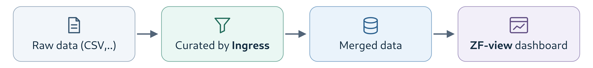

# zarr-fuse

## Overview



**zarr-fuse** is a Python library and collection of web applications for collaborative collection of scientific datasets
and their publication under [FAIR principles](...). 

1. Data "manager" can setup a formal schema for the target merged dataset and data checking and transformation pipeline
from predefined filters or by own code in Python. 
2. Individual contributors can either provide continuous data streams or
upload data contributions manualy over a web interface that follows predefined schemas.
3. Dataset contribution is curated, checked and finaly merged to the target dataset. 
4. You can overview the target or intermediate datasets using a ZF-view dashboard component and
   posibly fix  the source data or processing pipeline as all datasets are versioned and 
   referencable by persistent identifiers.

**Do not deploy yet!** Project still under active development, version 1.0 will be ready at June 2027.
   

### Raw data

Inputs can include sensor readings, field records, and model outputs. The ingress service accepts uploads such as CSV
or JSON files and can fetch data from configured sources on a schedule.

### Curated by ingress

A project defines a *schema*, a file that specifies the expected quantities, coordinates, and units. The processing
pipeline converts tabular data to the agreed names and units and checks rules such as required coordinates and allowed
value ranges. An optional filter helps process late or out-of-order batches by the time recorded in the data.

### Merged data in Zarr

| Data model | Example dataset |
| --- | --- |
| **xarray** organizes related quantities as a dataset of arrays with named axes, called *dimensions*. The *coordinates* give those axes meaningful labels, such as timestamps, borehole names, or depths in metres. Rock temperature can vary with time, borehole, and depth, while a borehole's longitude depends only on the borehole. These labels let researchers select a particular site and date range, and let zarr-fuse place updates at the corresponding coordinates. **Zarr** is the storage format. It saves arrays in blocks called *chunks*, so readers can load the parts needed for a particular analysis. |   |

### Dashboard

The **dashboard** opens configured datasets from the store and provides an interactive map and time-series plots. In
the Bukov monitoring example, researchers can choose boreholes on a map and compare temperatures at selected depths.
This gives the team a quick way to see which series are available and spot gaps or unusual patterns worth investigating.

[Features, use cases, and technical concepts](docs/features.md)

## Install

Clone or download the sources, install from them:
```
pip install .
```

Install from gtihub:

```
pip install git+https://github.com/geomop/zarr_fuse.git
```

To get plotting features or example apps, add these keywords after the "source url" use e.g.
```
pip install .[plotting, apps]
```

`plotting` - provides functions:
- interactive selection of columns in the storage
- selection from the locations
- multiscale view of time dependent variables


## Development

Run `bash tools/setup_env.sh` in the root of the sources to create development virtual environment.
In particular it installs zarr_fuse as:

```
pip install -e .[dev]
```

The 'dev' dependency includes all dependencies needed for 'plotting' and 'apps' part.


Possible relation to an open source spreadsheet like cloud solutions:
https://chatgpt.com/share/68026c33-3808-8004-a80e-524428ed9de5

---

### Running S3 Viewer Locally with Docker

For local development and testing with S3-compatible storage, you can use [rclone](https://hub.docker.com/r/rclone/rclone) in a Docker container to expose an S3 browser UI.
Below are instructions to set up and run the rclone S3 web GUI using your custom rclone.conf.

#### Prerequisites
- Docker installed and running.
- An S3-compatible bucket and credentials.
- rclone.conf file configured for your S3 provider (see example below).


#### Example rclone.conf

Create a file at ~/rclone.conf with the following content (update credentials as needed):
```ini
[s3]
type = s3
provider = Other
access_key_id = access_key
secret_access_key = secret_key
endpoint = https://s3.cl4.du.cesnet.cz
region = du
```

#### Running the S3 Viewer

Run the following command in your terminal:

```sh
docker run -d -p 5572:5572 -v ~/rclone.conf:/config/rclone/rclone.conf rclone/rclone:latest rcd --rc-web-gui --rc-addr :5572 --rc-user admin --rc-pass heslo123
```

#### Notes

This will start the rclone remote control (rcd) with the web GUI on http://localhost:5572.

Login using:
```ini
Username: admin
Password: heslo123
```

The S3 remote defined in your rclone.conf (here, [moje_s3]) will be available for browsing and management.


## CESNET S3

### Members
[Perun](https://perun.e-infra.cz) -> "Access management" on the left -> organisation VO_tul_scifuse -> Members

- invite members
- or users can apply for membership through [the form](https://perun.cesnet.cz/fed/registrar/?vo=VO_tul_scifuse)
- membership is valid in 30 minutes after [approval](https://docs.du.cesnet.cz/en/docs/perun/user-approval) by the group administrator [

Key management policy:
- each user generates its own keys
- each user only see his own keys
- CESNET could attribute keys to users 

## Future improvements
- test parallel writes and reads
- linked storage nodes into xarray tree, e.g. different meteosites and moisture measurments in separate nodes, but allowing
  to index by common times and locations, but possibly rather support that during read using interpolation if needed.


### Direct ZARR - Polars link, without intermediate Pandas DF


ds.to_dask_dataframe().to_parquet() and then pl.scan_parquet()

Lazy Dask Pandas
ds.to_dask_dataframe() → partition-wise map_partitions(pl.from_pandas)
